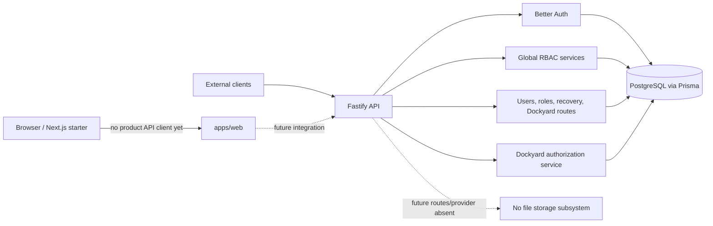
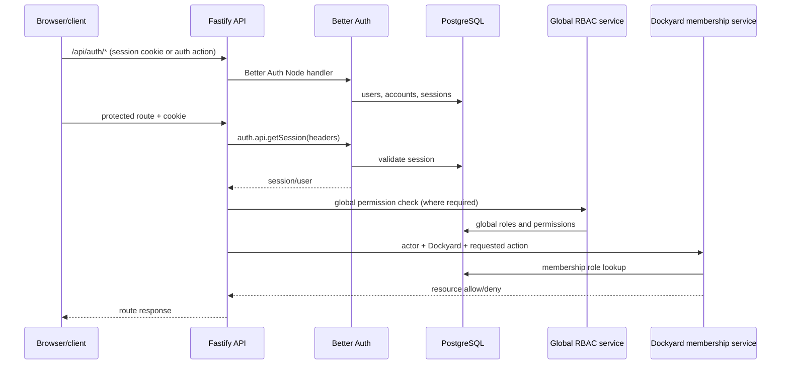
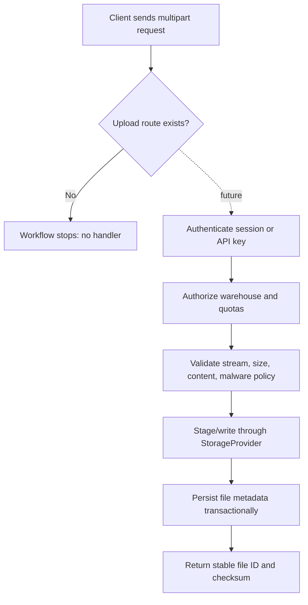
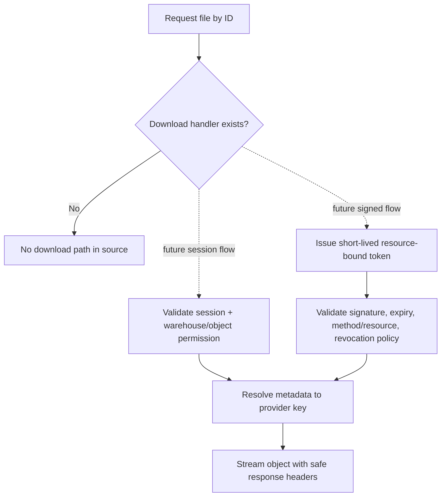

# Current architecture and target direction

## Current architecture

The checkout is a monorepo. The browser-facing Next.js app is currently a starter page. A separately deployed Fastify API mounts route plugins. Better Auth persists identity/session data through Prisma/PostgreSQL; a custom RBAC package handles global permissions, while Dockyard membership checks handle resource access. The schema now includes Dockyard members, key metadata fields, file metadata, lifecycle states, and audit events. File storage and API key issuance/validation are not implemented. **Dockyard is the product term for a Warehouse:** the existing `Dockyards` Prisma model and its IDs/relationships remain authoritative; there is no duplicate `Warehouse` model.



## Authentication and authorization (current)



The Dockyard membership roles are resource-level and distinct from global `Super Admin`, `Admin`, and user roles. A global Admin does not bypass membership. Super Admin may use a global access path, which writes an audit event for the affected Dockyard and action. API-key authentication is not implemented.

## Upload workflow (current and required)



`@fastify/multipart` is registered with 10 MiB file-size limit in `apps/api/src/app.ts`, but configuration alone does not implement upload behavior.

## Download and signed URL workflow (current and required)



No signed URL code exists. Requirements describe HMAC-SHA256, but this repository has no corresponding signing/validation functions.

## Metadata and physical storage (current and target)

```mermaid
erDiagram
  User ||--o{ Session : has
  User ||--o{ UserRole : assigned
  Role ||--o{ UserRole : grants
  Role ||--o{ RolePermission : contains
  Permission ||--o{ RolePermission : assigned
  User ||--o{ Dockyards : creates (Dockyard/Warehouse)
  Dockyards ||--o{ Api : groups (existing relation)
  User ||--o{ Api : creates
  Dockyards ||--o{ DockyardMember : grants
  User ||--o{ DockyardMember : belongs
  Dockyards ||--o{ DockyardFile : describes
  User o|--o{ DockyardFile : uploads
  Dockyards ||--o{ DockyardAuditEvent : records
  User o|--o{ DockyardAuditEvent : acts
```

`DockyardMember` uniquely relates a user to an existing Dockyard. Migration `20261118090000_dockyard_domain_foundation` backfills each existing Dockyard creator as `OWNER`. The existing `Api` model is extended in place: legacy rows keep their IDs and relations, and rows with null key digest/prefix remain non-authenticating. Migration `20261118120000_api_key_prefix` adds a nullable unique key prefix without changing existing credentials. `DockyardFile` stores metadata only; binary data remains outside PostgreSQL and no storage provider exists yet. File metadata refers to an opaque `storageKey`, never a user-controlled filesystem path.

Ownership changes are serialized by locking the parent `Dockyards` row inside a database transaction. Removal or demotion of an owner is rejected when it would leave no owner. The endpoint/service rule protects concurrent API requests; direct database writes outside this service must follow the same locking convention.

## Dockyard API (Checkpoint 2)

All listed routes require a Better Auth session cookie. Resource membership determines access; missing or unauthorized Dockyards return `404` to reduce existence disclosure. Creation retains the existing global `dockyard:create:any` requirement and adds the creator as `OWNER` atomically.

| Method and route | Access rule |
|---|---|
| `GET /api/dockyard` | List only memberships; Super Admin gets a globally audited list. |
| `GET /api/dockyard/active` | Same membership filter, restricted to ACTIVE. |
| `GET /api/dockyard/inactive` | Same membership filter, restricted to INACTIVE. |
| `GET /api/dockyard/incustody` | Same membership filter, restricted to INCUSTODY. |
| `GET /api/dockyard/suspended` | Same membership filter, restricted to SUSPENDED. |
| `GET /api/dockyard/:dockyardId` | Any member; explicit, audited Super Admin access. |
| `POST /api/dockyard` | Authenticated actor with global `dockyard:create:any`; creates the Dockyard, owner membership, and audit event in one transaction. Body: `{ "notes": "..." }`. |
| `GET /api/dockyard/:dockyardId/members` | Owner or explicitly audited Super Admin. |
| `POST /api/dockyard/:dockyardId/members` | Owner or Super Admin; body `{ "userId": "...", "role": "OWNER|MANAGER|VIEWER" }`. |
| `PATCH /api/dockyard/:dockyardId/members/:userId` | Owner or Super Admin; body `{ "role": "OWNER|MANAGER|VIEWER" }`. |
| `DELETE /api/dockyard/:dockyardId/members/:userId` | Owner or Super Admin; rejects removal of the last Owner with `409`. |

Manager and Viewer cannot modify membership. Global Admin has no Dockyard bypass. Role checks are action-specific; future file and API-key handlers must use `canUploadFile`, `canDownloadFile`, `canDeleteFile`, and `canManageApiKeys` rather than relying on global permissions.

## API key lifecycle (Checkpoint 3)

API key management uses the existing `Api` table and Dockyard foreign key. Issuance creates a 32-byte random secret in the format `vfs_live_<16-hex-prefix>_<base64url-secret>`, stores only its SHA-256 digest and non-secret prefix, and discloses the secret only in the create or rotate response. Legacy rows without a digest/prefix cannot authenticate or rotate. Rotation creates a new row and revokes the old key in one transaction; the old credential stops working immediately. Expiration is optional; revoke/expiry timestamps and successful-use timestamps are retained.

The external scope names `READ`, `WRITE`, and `DELETE` map to database enum values `FILE_READ`, `FILE_WRITE`, and `FILE_DELETE`. They are independent capabilities, not an implicit hierarchy. API-key middleware validates `X-API-Key` with a constant-time digest comparison, requires an ACTIVE Dockyard, checks requested scopes and any route Dockyard binding, and never falls back to Better Auth when a supplied key is invalid. Fastify logging redacts API-key, authorization, and cookie headers. Successful and known-key rejected use writes audit events containing key ID/scopes or a rejection reason, never the secret/digest. `/api/integration/me` is limited to 120 requests/minute per client IP so rotating arbitrary invalid credentials cannot evade the limiter.

Management routes require a Better Auth session and Owner/Manager membership; Viewer and ordinary global Admin are denied. Explicit Super Admin access to management operations writes `SUPER_ADMIN_API_KEY_*` audit events. `GET /api/integration/me` uses API-key authentication only and returns key/Dockyard IDs, scopes, and expiration metadata.

| Method and route | Access rule |
|---|---|
| `POST /api/dockyard/:dockyardId/api-keys` | Session + Owner/Manager or audited Super Admin; returns raw secret once. |
| `GET /api/dockyard/:dockyardId/api-keys` | Session + Owner/Manager or audited Super Admin; metadata only. |
| `GET /api/dockyard/:dockyardId/api-keys/:keyId` | Session + Owner/Manager or audited Super Admin; metadata only. |
| `POST /api/dockyard/:dockyardId/api-keys/:keyId/rotate` | Session + Owner/Manager or audited Super Admin; immediately revokes old key and returns new secret once. |
| `DELETE /api/dockyard/:dockyardId/api-keys/:keyId` | Session + Owner/Manager or audited Super Admin; returns `204`. |
| `GET /api/integration/me` | Valid `X-API-Key`; no session fallback; no file scope required. |

## Architecture evaluation

- **Separation:** package boundaries are useful, but the API contains route-level database logic and password hashing; business workflows and persistence concerns are not consistently isolated.
- **Modularity:** RBAC service/repository patterns are a reasonable base. There is no storage port or file domain to extend yet.
- **Frontend/backend coupling:** currently low because the web app is disconnected; that is absence of integration, not a mature API contract.
- **Storage abstraction:** absent. Add a provider interface with put/open/delete/head or equivalent operations, streaming semantics, metadata, and provider-specific error mapping.
- **Consistency/concurrency:** relational database is a good base; future file/object writes need a staged state machine/outbox or compensating cleanup because DB and object store cannot share one transaction. Concurrent duplicate uploads need explicit idempotency/uniqueness policy.
- **S3 extensibility:** AWS env variables and package references do not constitute compatibility. Choose an S3-compatible SDK/config model behind a provider. Keep provider credentials server-side and separate from application API credentials.
- **External clients:** define API versioning, key scopes, per-warehouse authorization, idempotency, quotas, SDK examples, CORS policy for browser clients, and audit trail.

## Retain, refactor, replace

| Decision | Modules |
|---|---|
| Retain as foundations | Turborepo/pnpm layout, Fastify API, Prisma/PostgreSQL, Better Auth session baseline, RBAC repository/service concept, Docker packaging (after verification). |
| Refactor | `apps/api/src/routes/users/index.ts` (split service/schema/repository concerns), auth middleware logging, env configuration into feature-specific optional config, compose migration/seed startup, tests/scripts. |
| Retain and complete | `Dockyards` is the existing Warehouse model. Preserve its identity and relations; creation makes the authenticated creator an Owner in the same transaction. |
| Implemented foundation | Dockyard membership, Owner/Manager/Viewer policy, file metadata/lifecycle, existing `Api` key metadata fields, migration backfill, and audit events. |
| Add in later phases | Actual file storage and workflows, dashboard, OpenAPI generation, backup and operations docs. API key issuance/rotation/validation is implemented in Checkpoint 3. New records relate to existing Dockyards; no duplicate Warehouse entity. |

No complete rewrite is justified: database, auth, RBAC, and deployment foundations can be evolved. A file-domain implementation is new work, not a reason to discard those foundations.
